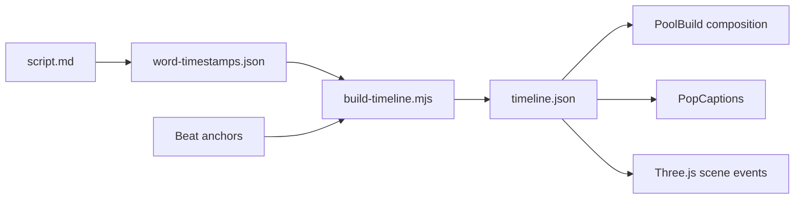

# ai-video-director

**Code-first vertical explainer videos** for TikTok, Reels, and Shorts — built with [Remotion](https://www.remotion.dev/) and timeline-driven 3D scenes. Teaches **AI coding agents** and humans to act as **directors**: script, beats, frame-accurate captions, and procedural visuals — no generative video API required.

Inspired by a pool-build showcase from [@ErnestoSOFTWARE on X](https://x.com/ErnestoSOFTWARE/status/2114523620026282002) (reference video is **not** included in this repo).

**Author:** [Alex Krzywicki](https://github.com/akrzywicki) — iOS developer, Russian-speaking creator ([YouTube: iOS на практике](https://www.youtube.com/@iosnapraktike)).


Short animated preview (first ~5s): `docs/preview/pool-build-preview.gif`

## Quickstart

```bash
npm install
npm run dev          # Remotion Studio — composition "PoolBuild"
npm run render:stills
npm run render:pool  # writes out/pool-build.mp4
```

No API keys needed: bundled `content/pool-build/word-timestamps.json` + `timeline.json` drive captions and scene events.

## What you get

| Deliverable | Description |
|-------------|-------------|
| **PoolBuild** composition | 1080×1920, 30fps, ~25s pool-build story |
| **Timeline JSON** | Words + scene `events` in frames |
| **3D cross-section** | Procedural backyard, excavation, rebar, shell, pipes, water, flow arrows |
| **Pop captions** | 1–2 words, white + black stroke, scale pop |
| **Optional pipeline** | ElevenLabs TTS + Whisper timestamps (env-gated scripts) |
| **AGENTS.md** | Full agent/human director workflow |

Agents: start with **`AGENTS.md`**. Cursor loads `.cursor/rules/ai-video-director.mdc`; Claude Code reads **`CLAUDE.md`**.

## How it works



1. **Script & beats** — hook-first narration and a beat table (`content/pool-build/script.md`).
2. **Word timings** — seconds per word (sample JSON included; replace via Whisper when you add real VO).
3. **`npm run timeline:build`** — merges words + visual events into `timeline.json`.
4. **Remotion** reads the timeline: `PopCaptions` for words; `src/scene/` maps `events[].kind` to motion.

Scene event kinds in the sample: `yard`, `excavate`, `rebar`, `concrete`, `pipes`, `water`, `flow`.

## Customization

- **Retime:** edit `content/pool-build/word-timestamps.json` and event frame ranges, then `npm run timeline:build`.
- **Visuals:** tweak `src/scene/BackyardCrossSection.tsx` and materials in `PoolScene3D.tsx`.
- **Caption look:** `src/components/PopCaptions.tsx` (font size, stroke, spring pop).
- **New topic:** copy `content/pool-build/`, add a composition in `src/Root.tsx`, implement a new scene module — see **Recipe** in `AGENTS.md`.

## Optional voice pipeline

Scripts skip gracefully without keys:

| Env var | Script | Output |
|---------|--------|--------|
| `ELEVENLABS_API_KEY` | `npm run pipeline:voice` | `public/voiceover.mp3` |
| `OPENAI_API_KEY` | `npm run pipeline:timestamps` | updates `word-timestamps.json` |

Then:

```bash
npm run timeline:build
# Set timeline.audio.optional to false and point src to voiceover.mp3 when ready
npm run render:pool
```

## Render commands

```bash
npm run render:stills    # docs/preview/frame-*.png
npm run render:preview   # first 5 seconds → out/pool-build-preview.mp4
npm run render:pool      # full video → out/pool-build.mp4
```

## Project layout

```
content/pool-build/     Script, word timestamps, timeline JSON
scripts/                build-timeline + optional TTS/Whisper
src/compositions/       Remotion entry components
src/scene/              R3F / Three.js visuals
src/director/           Timeline types & loader
docs/preview/           Rendered PNG previews (after stills)
AGENTS.md               Director playbook for agents
```

## License

MIT — see [LICENSE](LICENSE).

## Rough edges (honest)

- Sample word timings are **hand-authored**, not from real TTS; swap in Whisper output for pixel-perfect sync.
- 3D is **stylized** (boxes, lines, chunks) — not Blender-grade soil/fluid sim from the reference.
- Audio is **off by default** (`timeline.audio.optional`) so clones render silently without bundled VO.
