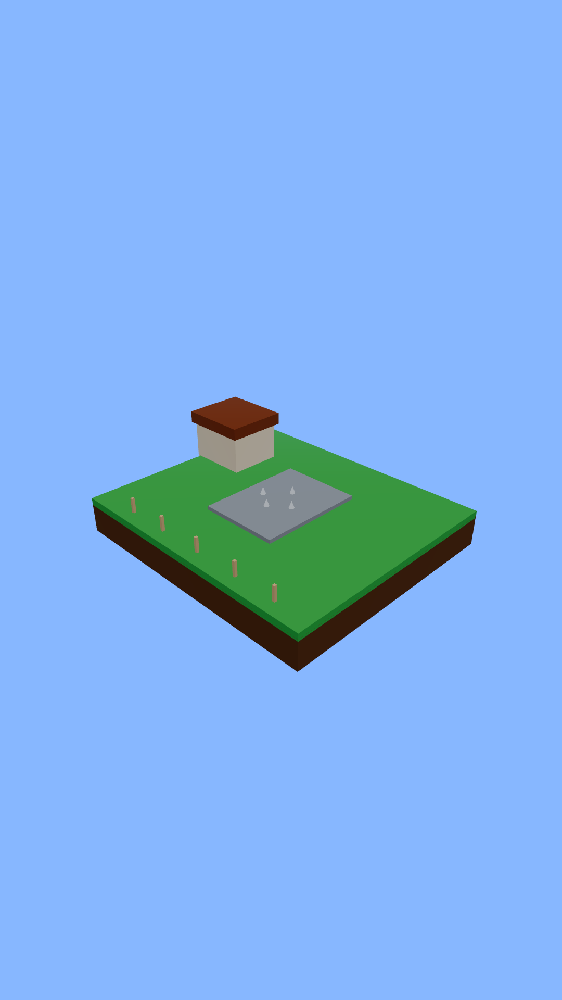
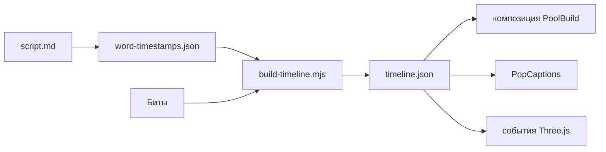

# ai-video-director

**Вертикальные explainer-ролики полностью в коде** для TikTok, Reels и Shorts — на [Remotion](https://www.remotion.dev/) и 3D-сценах по таймлайну. Репозиторий учит **AI-агентов** и людей работать как **режиссёр**: сценарий, биты, покадровые субтитры и процедурная графика — без generative video.

Вдохновение — ролик про строительство бассейна от [@ErnestoSOFTWARE в X](https://x.com/ErnestoSOFTWARE/status/2114523620026282002) (сам референс **не** лежит в репозитории из‑за авторских прав).

**Автор:** [Alex Krzywicki](https://github.com/akrzywicki) — iOS-разработчик, автор канала [«iOS на практике»](https://www.youtube.com/@iosnapraktike).



Короткий GIF-превью (~5 с): `docs/preview/pool-build-preview.gif`

## Быстрый старт

```bash
npm install
npm run dev          # Remotion Studio — композиция «PoolBuild»
npm run render:stills
npm run render:pool  # out/pool-build.mp4
```

API-ключи **не нужны**: в репозитории уже есть `word-timestamps.json` и `timeline.json`.

## Что внутри

| Компонент | Описание |
|-----------|----------|
| **PoolBuild** | 1080×1920, 30 fps, ~25 с — история стройки бассейна |
| **timeline.json** | Слова и события сцены в кадрах |
| **3D-разрез** | Двор, котлован, арматура, бетон, трубы, вода, стрелки потока |
| **Субтитры** | 1–2 слова, белый текст с обводкой, «pop» масштабом |
| **Пайплайн (опционально)** | ElevenLabs + Whisper через переменные окружения |
| **AGENTS.md** | Пошаговый workflow для агентов и людей |

Для агентов: **`AGENTS.md`**. В Cursor — правило `.cursor/rules/ai-video-director.mdc`; для Claude Code — **`CLAUDE.md`**.

## Как устроено



1. **Сценарий и биты** — `content/pool-build/script.md`.
2. **Тайминг слов** — JSON (образец; замените после Whisper).
3. **`npm run timeline:build`** — собирает `timeline.json`.
4. Remotion: субтитры + движение по полям `events[].kind`.

Типы событий в примере: `yard`, `excavate`, `rebar`, `concrete`, `pipes`, `water`, `flow`.

## Кастомизация

- **Тайминг:** правьте `word-timestamps.json` и кадры событий → `npm run timeline:build`.
- **Картинка:** `src/scene/BackyardCrossSection.tsx`.
- **Субтитры:** `src/components/PopCaptions.tsx`.
- **Новая тема:** копируйте `content/pool-build/`, новая композиция в `src/Root.tsx` — рецепт в **`AGENTS.md`**.

## Озвучка (опционально)

| Переменная | Команда | Результат |
|------------|---------|-----------|
| `ELEVENLABS_API_KEY` | `npm run pipeline:voice` | `public/voiceover.mp3` |
| `OPENAI_API_KEY` | `npm run pipeline:timestamps` | обновлённый `word-timestamps.json` |

Далее: `npm run timeline:build`, включите аудио в timeline и `npm run render:pool`.

## Рендер

```bash
npm run render:stills
npm run render:preview   # первые 5 секунд
npm run render:pool
```

## Структура

```
content/pool-build/     сценарий, тайминги, timeline
scripts/                сборка таймлайна, TTS/Whisper
src/                    Remotion + сцена + режиссёрская логика
docs/preview/           PNG-превью после render:stills
AGENTS.md               playbook для агентов
```

## Лицензия

MIT — [LICENSE](LICENSE).

## Что пока сыро

- Тайминги слов **ручные**, не с реального TTS — для идеального sync прогоните Whisper.
- 3D **упрощённая** стилизация, не симуляция Blender из референса.
- Звук **выключен по умолчанию** (`audio.optional`), чтобы клон собирался без озвучки.
